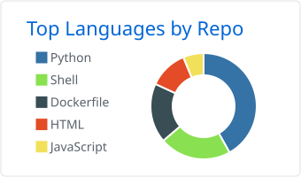
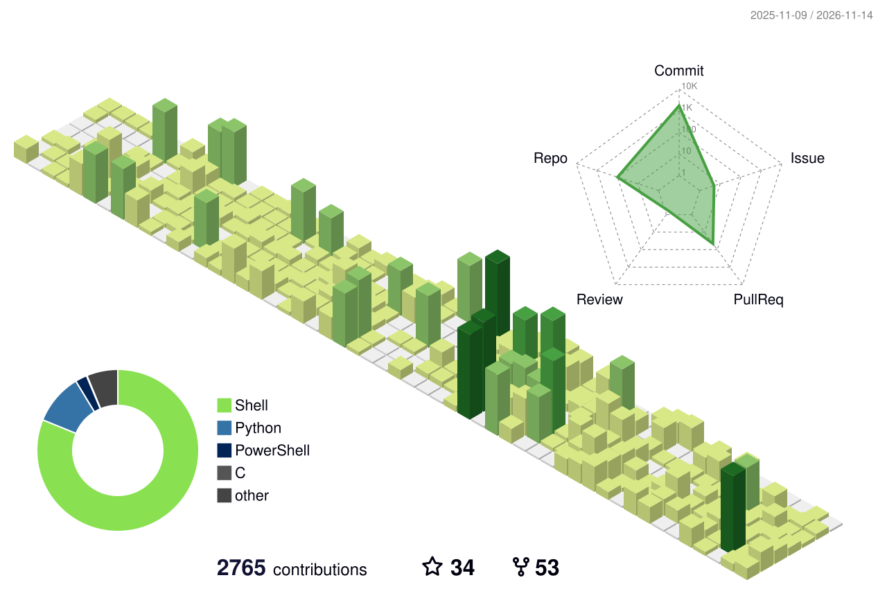
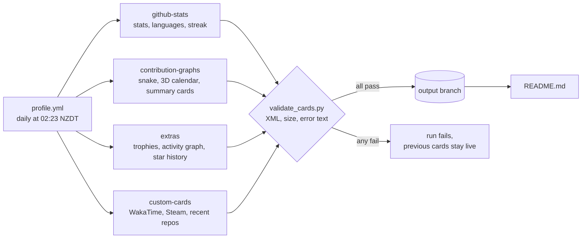

<picture>
  <source media="(prefers-color-scheme: dark)" srcset="assets/header-dark.svg">
  
</picture>

  
  
  
  
  

I build, compile and tweak niche code. Most of what I ship is automation that keeps running
after I stop looking at it: a router that flashes its own firmware, a kernel that rebuilds the
moment upstream moves, and Windows packages that publish themselves every six hours.

**Contents:** [About](#about) · [Toolbox](#toolbox) · [Current work](#current-work) ·
[Earlier projects](#earlier-projects) · [GitHub stats](#github-stats) ·
[Activity](#activity) · [How this profile works](#how-this-profile-works)

## About

- **Working on:** keeping a GL.iNet Flint 2 on SNAPSHOT firmware without touching it, and a
  CachyOS server kernel tuned for an ASUS NUC 16 Pro.
- **Home lab:** OpenWrt-based router, an Arch-based server running a custom kernel with
  sched-ext schedulers, and Windows packages that update themselves.
- **Ask me about:** firmware update pipelines, kernel builds in CI, Telegram bots, packaging for
  WinGet and Scoop.
- **Earlier:** Telegram leech and mirror bots that were forked hundreds of times, Google Drive
  tooling, and an Android Magisk module for Exynos devices.

<a href="#top">back to top</a>

## Toolbox

  
  
  
  
  
  
  
  
  
  
  
  
  
  

<a href="#top">back to top</a>

## Current work

| Project | What it does | Status |
| --- | --- | --- |
| [gl-inet-mt6000-auto-snapshot](https://github.com/AmirulAndalib/gl-inet-mt6000-auto-snapshot) | Keeps a GL.iNet Flint 2 (GL-MT6000) on the latest SNAPSHOT firmware. Pure POSIX shell and AWK, checks SHA256 before every flash, and survives its own upgrades. |   |
| [asus-nuc16pro-cachyos-server-edge-kernel](https://github.com/AmirulAndalib/asus-nuc16pro-cachyos-server-edge-kernel) | Builds the CachyOS server kernel and sched-ext schedulers for an ASUS NUC 16 Pro, and triggers a rebuild as soon as it drifts from upstream. |   |
| [nvpi-r-auto](https://github.com/AmirulAndalib/nvpi-r-auto) | Unofficial WinGet and Scoop packaging for NVIDIA Profile Inspector and NVPI Revamped, checked for new releases every six hours. |   |
| [mvolt-scoop](https://github.com/AmirulAndalib/mvolt-scoop) | Unofficial Scoop bucket for mVolt+, the NVIDIA GPU tuning tool. |  |

<picture>
  <source media="(prefers-color-scheme: dark)" srcset="https://raw.githubusercontent.com/AmirulAndalib/AmirulAndalib/output/repos-dark.svg">
  
</picture>

<a href="#top">back to top</a>

## Earlier projects

| Project | What it does | Reach |
| --- | --- | --- |
| [TL-GD](https://github.com/AmirulAndalib/TL-GD) | Telegram bot that leeches torrents and direct links to Google Drive. A modified fork of TorrentLeech-Gdrive. |   |
| [Tor-Toolkit](https://github.com/AmirulAndalib/Tor-Toolkit) | Telegram torrent and youtube-dl leecher built on qBittorrent, adapted to run on Heroku. |   |
| [GdriveTools](https://github.com/AmirulAndalib/GdriveTools) | Python tool for Google Drive: creates service accounts, adds them to shared drives, and generates OAuth tokens. |   |
| [MLTB-ALPINE-DOCKER](https://github.com/AmirulAndalib/MLTB-ALPINE-DOCKER) | Alpine Edge Docker image for Mirror Leech Telegram Bot, built for amd64, arm64 and armv7. |   |
| [Scene7_ExtremeGT](https://github.com/AmirulAndalib/Scene7_ExtremeGT) | Unofficial Extreme GT Magisk module with power and thermal profiles for Samsung Exynos devices. |   |

Star history of the bots and tools

 
<picture>
  <source media="(prefers-color-scheme: dark)" srcset="https://raw.githubusercontent.com/AmirulAndalib/AmirulAndalib/output/star-history-dark.svg">
  
</picture>

<a href="#top">back to top</a>

## GitHub stats

  <picture>
    <source media="(prefers-color-scheme: dark)" srcset="https://raw.githubusercontent.com/AmirulAndalib/AmirulAndalib/output/stats-dark.svg">
    
  </picture>
  <picture>
    <source media="(prefers-color-scheme: dark)" srcset="https://raw.githubusercontent.com/AmirulAndalib/AmirulAndalib/output/languages-dark.svg">
    
  </picture>

  <picture>
    <source media="(prefers-color-scheme: dark)" srcset="https://raw.githubusercontent.com/AmirulAndalib/AmirulAndalib/output/streak-dark.svg">
    
  </picture>
  <picture>
    <source media="(prefers-color-scheme: dark)" srcset="https://raw.githubusercontent.com/AmirulAndalib/AmirulAndalib/output/productive-time-dark.svg">
    
  </picture>

  <picture>
    <source media="(prefers-color-scheme: dark)" srcset="https://raw.githubusercontent.com/AmirulAndalib/AmirulAndalib/output/repos-per-language-dark.svg">
    
  </picture>
  <picture>
    <source media="(prefers-color-scheme: dark)" srcset="https://raw.githubusercontent.com/AmirulAndalib/AmirulAndalib/output/commit-language-dark.svg">
    
  </picture>

<picture>
  <source media="(prefers-color-scheme: dark)" srcset="https://raw.githubusercontent.com/AmirulAndalib/AmirulAndalib/output/trophy-dark.svg">
  
</picture>

<a href="#top">back to top</a>

## Activity

<picture>
  <source media="(prefers-color-scheme: dark)" srcset="https://raw.githubusercontent.com/AmirulAndalib/AmirulAndalib/output/activity-dark.svg">
  
</picture>

<picture>
  <source media="(prefers-color-scheme: dark)" srcset="https://raw.githubusercontent.com/AmirulAndalib/AmirulAndalib/output/contributions-3d-dark.svg">
  
</picture>

<!-- Coding and gaming: enabled once the profile workflow can run with the WakaTime and Steam secrets.
<picture>
  <source media="(prefers-color-scheme: dark)" srcset="https://raw.githubusercontent.com/AmirulAndalib/AmirulAndalib/output/wakatime-dark.svg">
  
</picture>
<picture>
  <source media="(prefers-color-scheme: dark)" srcset="https://raw.githubusercontent.com/AmirulAndalib/AmirulAndalib/output/steam-dark.svg">
  
</picture>
-->

<picture>
  <source media="(prefers-color-scheme: dark)" srcset="https://raw.githubusercontent.com/AmirulAndalib/AmirulAndalib/output/snake-dark.svg">
  
</picture>

<a href="#top">back to top</a>

## How this profile works

Every card here is rendered by my own workflow, not by a hosted service

 

Most profile cards you see on GitHub point at shared Vercel instances. In November 2026 those
returned HTTP 503 or 402, so this profile renders everything itself and commits the results to
the [output](https://github.com/AmirulAndalib/AmirulAndalib/tree/output) branch. A run that
produces a broken card fails instead of publishing it.

All third-party actions are pinned to full commit SHAs. The WakaTime, Steam and recent-repos
cards come from small standard-library Python scripts in [scripts/cards](scripts/cards).

Rendered by [profile.yml](.github/workflows/profile.yml) · cards published to the
[output](https://github.com/AmirulAndalib/AmirulAndalib/tree/output) branch
