<picture>
  <source media="(prefers-color-scheme: dark)" srcset="assets/header-dark.svg">
  
</picture>
  

  
  
  
  

  
  
  
  
  

DevOps, cloud and Linux sysadmin with a cybersecurity streak. Building, compiling, and tweaking
niche code, driven by low-level curiosity, automated pipelines, and optimization experiments that
make my day. Most of what I run keeps itself up to date: a router that flashes its own firmware,
a kernel that rebuilds the moment upstream moves, and packages that publish themselves every six
hours.

  <a href="#about">About</a> ·
  <a href="#toolbox">Toolbox</a> ·
  <a href="#current-work">Current work</a> ·
  <a href="#open-source-contributions">Upstream contributions</a> ·
  <a href="#earlier-projects">Earlier projects</a> ·
  <a href="#github-stats">GitHub stats</a> ·
  <a href="#activity">Activity</a> ·
  <a href="#coding-time">Coding time</a>

## About

- **What I do:** DevOps and CI/CD pipelines, cloud deploys, Linux administration, and keeping
  infrastructure patched, locked down and boring.
- **Working on:** a GL.iNet Flint 2 that stays on SNAPSHOT firmware by itself, and a CachyOS
  server kernel with sched-ext schedulers tuned for an ASUS NUC 16 Pro.
- **Home lab:** OpenWrt router, Arch-based server on a custom kernel, AdGuard Home and Pi-hole for
  DNS filtering, Home Assistant, and Docker stacks for self-hosted apps.
- **Security side:** supply-chain hygiene (SHA-pinned actions, secret scanning with GitGuardian
  and gitleaks, Semgrep), least-privilege tokens, and auditing what actually runs on my accounts.
- **Ask me about:** firmware update pipelines, kernel builds in CI, GitHub Actions cost and
  security, WinGet and Scoop packaging, Telegram bots.
- **Earlier:** Telegram leech and mirror bots forked hundreds of times, Google Drive tooling, and
  an Android Magisk module for Exynos devices.

GitHub achievements

 

  
  
  
  
  
  
  
  
  

<a href="#top">back to top</a>

## Toolbox

  <picture>
    <source media="(prefers-color-scheme: dark)" srcset="https://raw.githubusercontent.com/AmirulAndalib/AmirulAndalib/output/skills-dark.svg">
    
  </picture>

  
  
  
  
  
  
  
  
  
  
  
  
  
  

<b>Cloud and platforms</b> 
  
  
  
  
  
  
  
  
  
  

<b>Infrastructure and home lab</b> 
  
  
  
  
  
  
  
  
  
  

<b>Security</b> 
  
  
  
  
  
  

<a href="#top">back to top</a>

## Current work

| Project | What it does | Status |
| --- | --- | --- |
| [gl-inet-mt6000-auto-snapshot](https://github.com/AmirulAndalib/gl-inet-mt6000-auto-snapshot) | Keeps a GL.iNet Flint 2 (GL-MT6000) on the latest SNAPSHOT firmware. Pure POSIX shell and AWK, checks SHA256 before every flash, and survives its own upgrades. |   |
| [asus-nuc16pro-cachyos-server-edge-kernel](https://github.com/AmirulAndalib/asus-nuc16pro-cachyos-server-edge-kernel) | Builds the CachyOS server kernel and sched-ext schedulers for an ASUS NUC 16 Pro, and triggers a rebuild as soon as it drifts from upstream. |   |
| [nvpi-r-auto](https://github.com/AmirulAndalib/nvpi-r-auto) | Unofficial WinGet and Scoop packaging for NVIDIA Profile Inspector and NVPI Revamped, checked for new releases every six hours. |   |
| [mvolt-scoop](https://github.com/AmirulAndalib/mvolt-scoop) | Unofficial Scoop bucket for mVolt+, the NVIDIA GPU tuning tool. |  |

<picture>
  <source media="(prefers-color-scheme: dark)" srcset="https://raw.githubusercontent.com/AmirulAndalib/AmirulAndalib/output/repos-dark.svg">
  
</picture>

<a href="#top">back to top</a>

## Open source contributions

Merged pull requests to projects I don't own.

| Project | Merged | What I contributed |
| --- | --- | --- |
| [openwrt/luci](https://github.com/openwrt/luci/pulls?q=is%3Apr+author%3AAmirulAndalib+is%3Amerged) |  | Added the `luci-app-openspeedtest` package to the OpenWrt web interface |
| [microsoft/winget-pkgs](https://github.com/microsoft/winget-pkgs/pulls?q=is%3Apr+author%3AAmirulAndalib) |  | Package manifests, including b00nz.mVolt releases |
| [yash-dk/TorToolkit-Telegram](https://github.com/yash-dk/TorToolkit-Telegram/pulls?q=is%3Apr+author%3AAmirulAndalib) |  | Server and home page fixes for the upstream TorToolkit bot |
| Others |  | Docker build for MERGE-BOT, a compiler-flag fix for megasdkrest, a CI fix for slimhub_actions, and fixes to boibrary-astro |

<a href="#top">back to top</a>

## Earlier projects

| Project | What it does | Reach |
| --- | --- | --- |
| [TL-GD](https://github.com/AmirulAndalib/TL-GD) | Telegram bot that leeches torrents and direct links to Google Drive. A modified fork of TorrentLeech-Gdrive. |   |
| [Tor-Toolkit](https://github.com/AmirulAndalib/Tor-Toolkit) | Telegram torrent and youtube-dl leecher built on qBittorrent, adapted to run on Heroku. |   |
| [GdriveTools](https://github.com/AmirulAndalib/GdriveTools) | Python tool for Google Drive: creates service accounts, adds them to shared drives, and generates OAuth tokens. |   |
| [MLTB-ALPINE-DOCKER](https://github.com/AmirulAndalib/MLTB-ALPINE-DOCKER) | Alpine Edge Docker image for Mirror Leech Telegram Bot, built for amd64, arm64 and armv7. |   |
| [Scene7_ExtremeGT](https://github.com/AmirulAndalib/Scene7_ExtremeGT) | Unofficial Extreme GT Magisk module with power and thermal profiles for Samsung Exynos devices. |   |

Repository cards

 

<a href="https://github.com/AmirulAndalib/gl-inet-mt6000-auto-snapshot"><picture><source media="(prefers-color-scheme: dark)" srcset="https://raw.githubusercontent.com/AmirulAndalib/AmirulAndalib/output/pin-gl-inet-mt6000-auto-snapshot-dark.svg"></picture></a>
<a href="https://github.com/AmirulAndalib/asus-nuc16pro-cachyos-server-edge-kernel"><picture><source media="(prefers-color-scheme: dark)" srcset="https://raw.githubusercontent.com/AmirulAndalib/AmirulAndalib/output/pin-asus-nuc16pro-cachyos-server-edge-kernel-dark.svg"></picture></a>
<a href="https://github.com/AmirulAndalib/nvpi-r-auto"><picture><source media="(prefers-color-scheme: dark)" srcset="https://raw.githubusercontent.com/AmirulAndalib/AmirulAndalib/output/pin-nvpi-r-auto-dark.svg"></picture></a>
<a href="https://github.com/AmirulAndalib/mvolt-scoop"><picture><source media="(prefers-color-scheme: dark)" srcset="https://raw.githubusercontent.com/AmirulAndalib/AmirulAndalib/output/pin-mvolt-scoop-dark.svg"></picture></a>
<a href="https://github.com/AmirulAndalib/TL-GD"><picture><source media="(prefers-color-scheme: dark)" srcset="https://raw.githubusercontent.com/AmirulAndalib/AmirulAndalib/output/pin-TL-GD-dark.svg"></picture></a>
<a href="https://github.com/AmirulAndalib/Tor-Toolkit"><picture><source media="(prefers-color-scheme: dark)" srcset="https://raw.githubusercontent.com/AmirulAndalib/AmirulAndalib/output/pin-Tor-Toolkit-dark.svg"></picture></a>
<a href="https://github.com/AmirulAndalib/GdriveTools"><picture><source media="(prefers-color-scheme: dark)" srcset="https://raw.githubusercontent.com/AmirulAndalib/AmirulAndalib/output/pin-GdriveTools-dark.svg"></picture></a>
<a href="https://github.com/AmirulAndalib/MLTB-ALPINE-DOCKER"><picture><source media="(prefers-color-scheme: dark)" srcset="https://raw.githubusercontent.com/AmirulAndalib/AmirulAndalib/output/pin-MLTB-ALPINE-DOCKER-dark.svg"></picture></a>

Star history of the bots and tools

 
<picture>
  <source media="(prefers-color-scheme: dark)" srcset="https://raw.githubusercontent.com/AmirulAndalib/AmirulAndalib/output/star-history-dark.svg">
  
</picture>

<a href="#top">back to top</a>

## GitHub stats

  <picture>
    <source media="(prefers-color-scheme: dark)" srcset="https://raw.githubusercontent.com/AmirulAndalib/AmirulAndalib/output/stats-dark.svg">
    
  </picture>
  <picture>
    <source media="(prefers-color-scheme: dark)" srcset="https://raw.githubusercontent.com/AmirulAndalib/AmirulAndalib/output/languages-dark.svg">
    
  </picture>

  <picture>
    <source media="(prefers-color-scheme: dark)" srcset="https://raw.githubusercontent.com/AmirulAndalib/AmirulAndalib/output/streak-dark.svg">
    
  </picture>
  <picture>
    <source media="(prefers-color-scheme: dark)" srcset="https://raw.githubusercontent.com/AmirulAndalib/AmirulAndalib/output/productive-time-dark.svg">
    
  </picture>

  <picture>
    <source media="(prefers-color-scheme: dark)" srcset="https://raw.githubusercontent.com/AmirulAndalib/AmirulAndalib/output/repos-per-language-dark.svg">
    
  </picture>
  <picture>
    <source media="(prefers-color-scheme: dark)" srcset="https://raw.githubusercontent.com/AmirulAndalib/AmirulAndalib/output/commit-language-dark.svg">
    
  </picture>

<picture>
  <source media="(prefers-color-scheme: dark)" srcset="https://raw.githubusercontent.com/AmirulAndalib/AmirulAndalib/output/trophy-dark.svg">
  
</picture>

<a href="#top">back to top</a>

## Activity

<picture>
  <source media="(prefers-color-scheme: dark)" srcset="https://raw.githubusercontent.com/AmirulAndalib/AmirulAndalib/output/activity-dark.svg">
  
</picture>

<picture>
  <source media="(prefers-color-scheme: dark)" srcset="https://raw.githubusercontent.com/AmirulAndalib/AmirulAndalib/output/contributions-3d-dark.svg">
  
</picture>

## Coding time

Tracked by WakaTime across my editors and Claude Code.

<picture>
  <source media="(prefers-color-scheme: dark)" srcset="https://raw.githubusercontent.com/AmirulAndalib/AmirulAndalib/output/wakatime-dark.svg">
  
</picture>

<!-- Steam: enable once the Steam profile and game details are public.
<picture>
  <source media="(prefers-color-scheme: dark)" srcset="https://raw.githubusercontent.com/AmirulAndalib/AmirulAndalib/output/steam-dark.svg">
  
</picture>
-->

<picture>
  <source media="(prefers-color-scheme: dark)" srcset="https://raw.githubusercontent.com/AmirulAndalib/AmirulAndalib/output/snake-dark.svg">
  
</picture>

<a href="#top">back to top</a>

